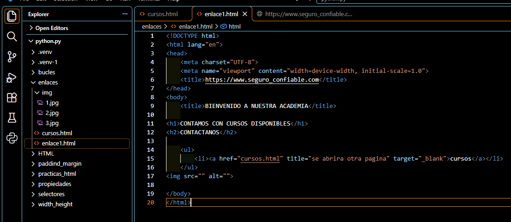
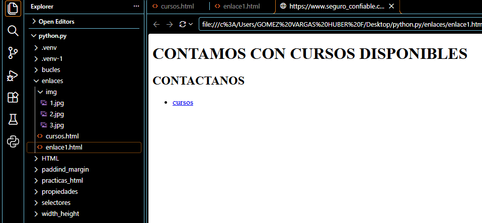
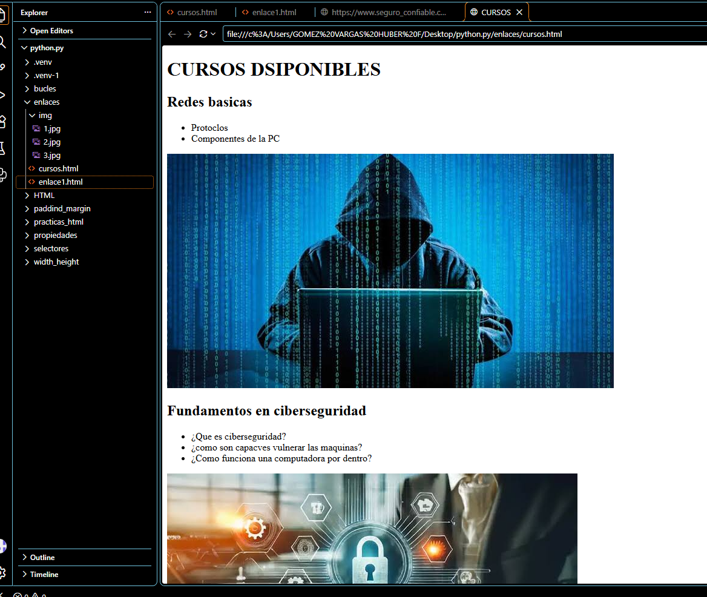
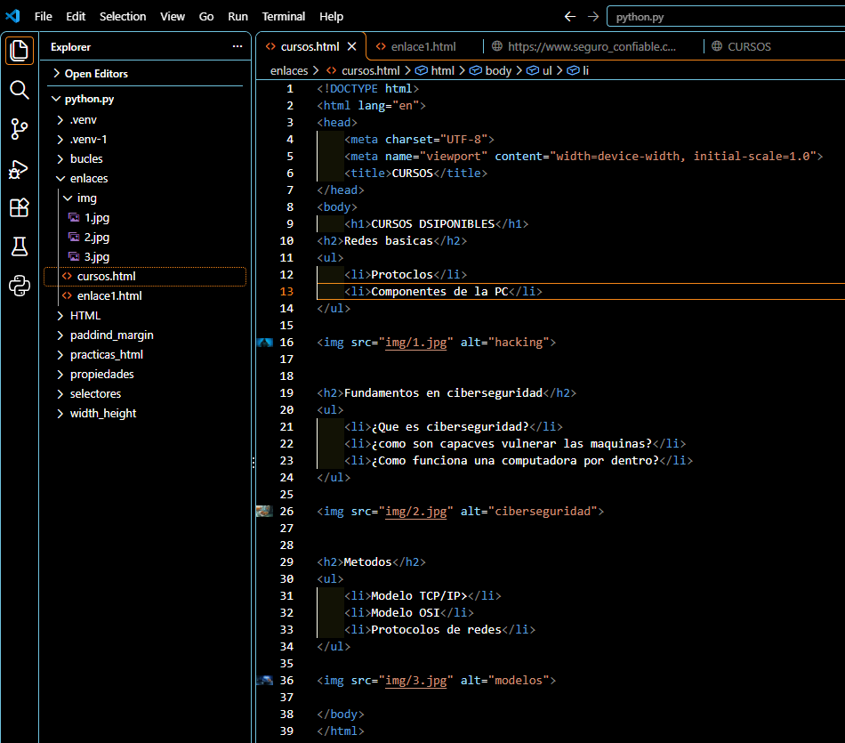

# Práctica 01: Mi primera página web con HTML

## 📌 ¿Qué aprendí?

En esta práctica comencé a desarrollar páginas web utilizando HTML desde Visual Studio Code. El ejercicio consistió en crear una página principal para una academia que ofrece cursos y una segunda página para mostrar los cursos disponibles. Durante el desarrollo, aprendí a organizar el contenido, insertar imágenes y establecer enlaces entre diferentes páginas.

## 🛠️ Desarrollo de la práctica

### 1. Creación del código HTML de la página principal

Primero, elaboré el archivo `enlace1.html`, donde definí la estructura básica del documento HTML mediante etiquetas como `<!DOCTYPE html>`, `<html>`, `<head>` y `<body>`. También agregué un encabezado de bienvenida, títulos y un enlace para acceder a la página de cursos.

### 2. Visualización de la página principal

Después de escribir el código, abrí el archivo en el navegador para comprobar cómo se mostraba el contenido. Observé los encabezados y el enlace que permite acceder a los cursos disponibles. Para crear la navegación utilicé la etiqueta `<a>`, junto con el atributo `href`.

### 3. Creación de la página de cursos disponibles

A continuación, desarrollé el archivo `cursos.html`, en el que organicé los cursos en diferentes secciones. Incluí temas de redes básicas, como protocolos y componentes de una PC, y fundamentos de ciberseguridad. También agregué imágenes relacionadas con los temas utilizando la etiqueta ``.

### 4. Código HTML de la página de cursos

Finalmente, revisé el código de `cursos.html` para identificar cómo se utilizan las listas con `<ul>` y `<li>`, los subtítulos con `<h2>` y las imágenes con ``. Esta parte me permitió comprender mejor cómo organizar la información de una página web de forma sencilla y ordenada.

## 📚 Lo que aprendí

- Comprendí la estructura básica de un documento HTML.
- Aprendí a crear encabezados, subtítulos y listas.
- Practiqué la inserción de imágenes en una página web.
- Aprendí a conectar dos documentos HTML mediante enlaces.
- Comprobé cómo se visualiza el código HTML en un navegador.

## ✅ Resultado

Logré desarrollar dos páginas web relacionadas entre sí: una página principal y otra dedicada a los cursos disponibles. Esta práctica representa uno de mis primeros pasos en el aprendizaje del desarrollo web y me proporciona una base para continuar estudiando HTML y posteriormente CSS.

## 🎯 Próximo paso

Continuar practicando las etiquetas HTML y comenzar a aplicar CSS para mejorar la apariencia, los colores, las dimensiones y la distribución de los elementos de mis páginas web.
