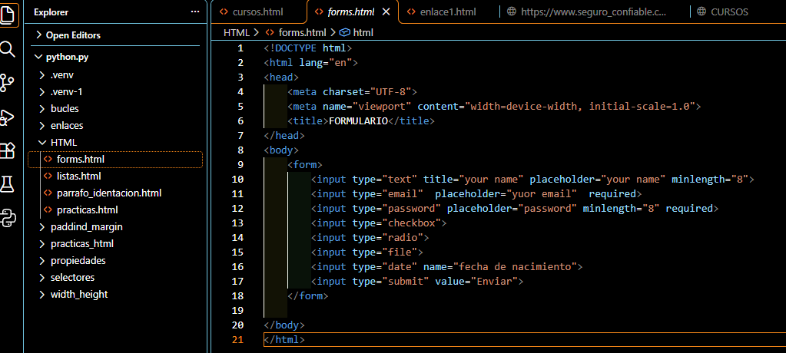
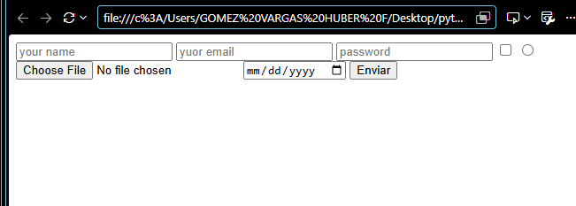
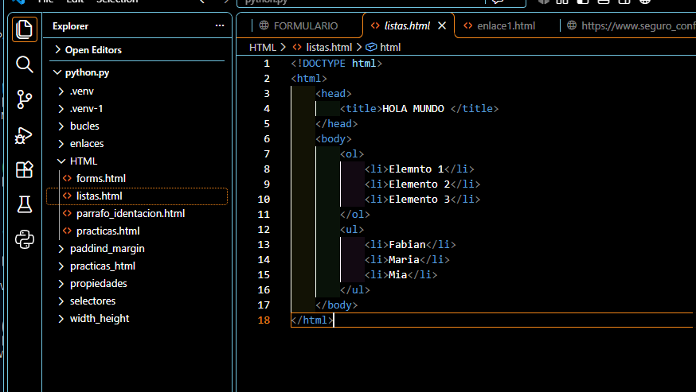
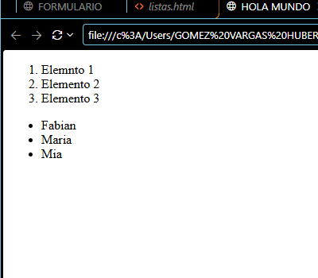
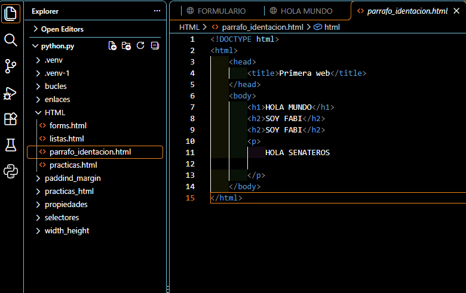
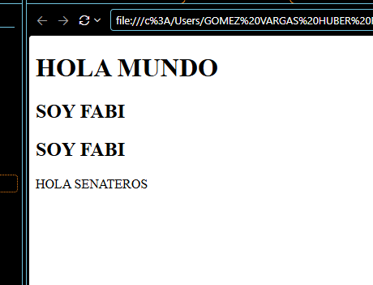
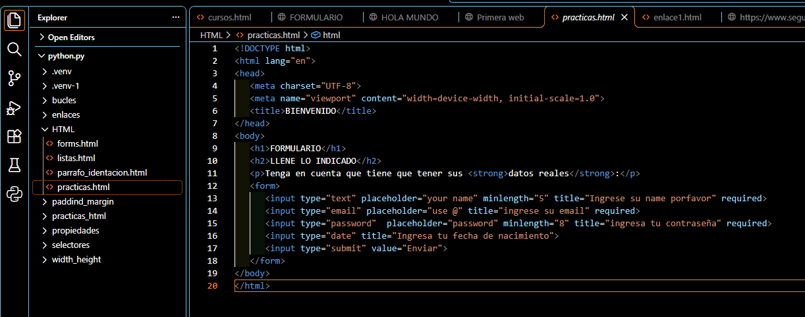
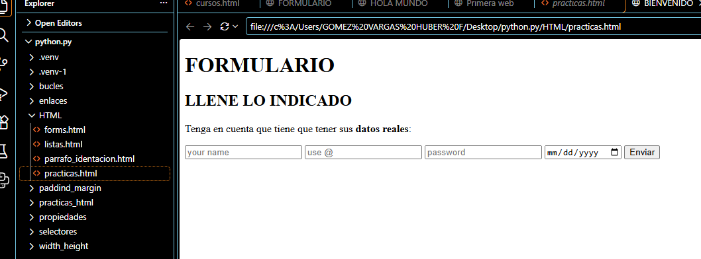

# Práctica 02: Formularios, listas y párrafos con HTML

## 📌 ¿Qué aprendí?

En esta práctica continué aprendiendo HTML desde Visual Studio Code. El ejercicio consistió en crear varias páginas para practicar elementos básicos: un formulario con distintos tipos de campos, listas ordenadas y no ordenadas, títulos y párrafos. Durante el desarrollo, aprendí a organizar el contenido, a validar datos en un formulario y a mantener el código ordenado con una buena indentación.

## 🛠️ Desarrollo de la práctica

### 1. Creación del código del formulario

Primero, elaboré el archivo `forms.html`, donde definí la estructura básica del documento HTML con etiquetas como `<!DOCTYPE html>`, `<html>`, `<head>` y `<body>`. Dentro del `<body>` agregué un `<form>` con diferentes tipos de `<input>`: texto, email, contraseña, checkbox, radio, archivo, fecha y un botón de envío. También utilicé atributos como `placeholder`, `minlength` y `required`.

### 2. Visualización del formulario

Después de escribir el código, abrí el archivo en el navegador para comprobar cómo se mostraban los campos. Observé cómo cada tipo de `input` cambia su apariencia, por ejemplo el selector de fecha y el botón para elegir un archivo.

### 3. Creación de las listas

A continuación, desarrollé el archivo `listas.html`, en el que practiqué los dos tipos de listas. Utilicé la etiqueta `<ol>` para una lista numerada y `<ul>` para una lista con viñetas, colocando cada elemento dentro de un `<li>`.

### 4. Visualización de las listas

Luego revisé el resultado en el navegador y pude ver cómo la lista ordenada muestra números y la lista no ordenada muestra viñetas.

### 5. Títulos, párrafos e indentación

Después creé el archivo `parrafo_identacion.html`, donde practiqué los títulos con `<h1>` y `<h2>` y los párrafos con `
`. Esta parte me ayudó a entender la importancia de la indentación para que el código sea más fácil de leer.

### 6. Visualización de títulos y párrafos

Al abrir el archivo en el navegador comprobé la diferencia de tamaño entre los títulos y cómo se muestra el texto del párrafo.

### 7. Práctica final: formulario completo

Finalmente, elaboré el archivo `practicas.html` para juntar todo lo aprendido. Agregué un título, un subtítulo, un párrafo con texto resaltado usando `<strong>` y un formulario con campos de nombre, email, contraseña y fecha de nacimiento, usando validaciones como `required` y `minlength`.

### 8. Visualización de la práctica final

Para terminar, abrí la página en el navegador y verifiqué que el formulario se viera correctamente y que los campos funcionaran como esperaba.

## ✅ Conclusión

Con esta práctica reforcé la estructura básica de una página HTML y aprendí a usar formularios, listas, títulos y párrafos. En las próximas prácticas voy a seguir con enlaces, imágenes y luego CSS para darle estilo a mis páginas.
