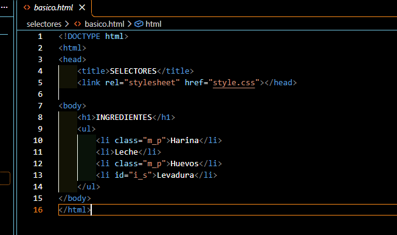
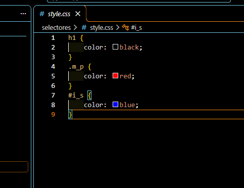
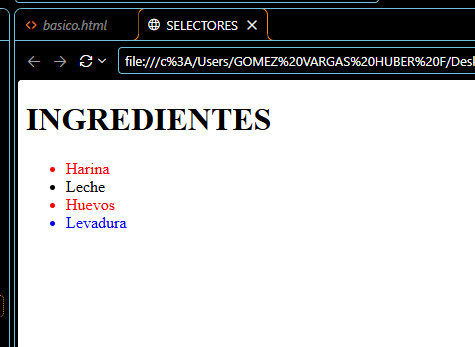

# Práctica 03: Mi primera hoja de estilos con CSS

## 📌 ¿Qué aprendí?

En esta práctica comencé a trabajar con CSS desde Visual Studio Code. El ejercicio consistió en crear una página con una lista de ingredientes y darle color a distintos elementos usando los tres selectores básicos: de etiqueta, de clase y de id. Durante el desarrollo, aprendí a conectar un archivo CSS con un archivo HTML y a elegir qué elementos quiero que cambien de estilo.

## 🛠️ Desarrollo de la práctica

### 1. Creación del código HTML

Primero, elaboré el archivo `basico.html`, donde definí la estructura básica del documento con las etiquetas `<!DOCTYPE html>`, `<html>`, `<head>` y `<body>`. Dentro del `<head>` agregué la etiqueta `<link>` con el atributo `href="style.css"` para conectar la hoja de estilos. En el `<body>` escribí un título `<h1>` y una lista `<ul>` con cuatro ingredientes: Harina, Leche, Huevos y Levadura. A Harina y Huevos les puse la clase `m_p` y a Levadura el id `i_s`.

### 2. Creación del código CSS

Después, creé el archivo `style.css`, donde apliqué los tres tipos de selectores:

- `h1`: selector de etiqueta, cambia el color del título a negro.
- `.m_p`: selector de clase (se escribe con punto), cambia a rojo los elementos que tengan esa clase.
- `#i_s`: selector de id (se escribe con numeral), cambia a azul el elemento que tenga ese id.

### 3. Visualización en el navegador

Finalmente, abrí el archivo en el navegador para comprobar el resultado. Harina y Huevos se ven en rojo porque comparten la clase `m_p`, Levadura se ve en azul por su id `i_s`, y Leche se queda en negro porque no tiene ningún selector asignado.

## 💡 Diferencia entre clase e id

Entendí que una **clase** se puede usar en varios elementos a la vez (como pasó con Harina y Huevos), mientras que un **id** debe ser único y se usa para un solo elemento (como Levadura).

## ✅ Conclusión

Con esta práctica aprendí a conectar CSS con HTML y a usar los selectores de etiqueta, clase e id para darle color a los elementos. En las próximas prácticas voy a seguir con más propiedades de CSS, como márgenes, padding y tamaños.
