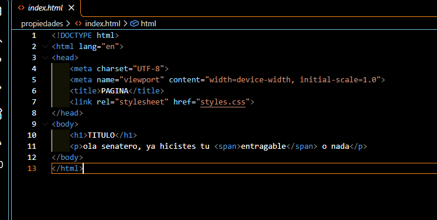
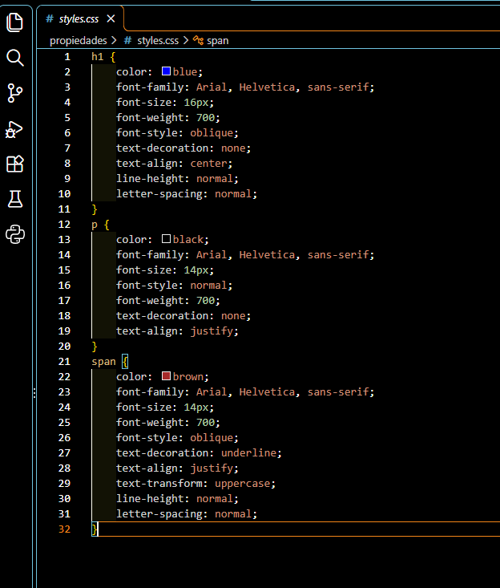
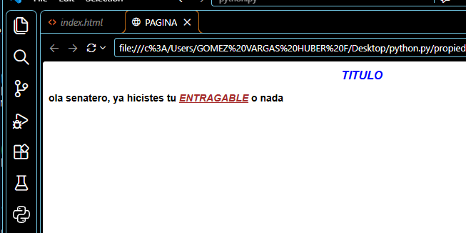

# Práctica 04: Propiedades de texto y fuente en CSS

## 📌 ¿Qué aprendí?

En esta práctica seguí trabajando con CSS desde Visual Studio Code. El ejercicio consistió en darle estilo a un título y a un párrafo, y también a una palabra resaltada dentro del párrafo. Durante el desarrollo, aprendí a usar varias propiedades para cambiar el color, la fuente, el tamaño, la alineación y la decoración del texto.

## 🛠️ Desarrollo de la práctica

### 1. Creación del código HTML

Primero, elaboré el archivo `index.html`, donde definí la estructura básica del documento y conecté la hoja de estilos con la etiqueta `<link>` y el atributo `href="styles.css"`. En el `<body>` escribí un título con `<h1>` y un párrafo con `
`. Dentro del párrafo usé la etiqueta `` para envolver una sola palabra y poder darle un estilo distinto al resto del texto.

### 2. Creación del código CSS

Después, creé el archivo `styles.css`, donde apliqué estilos a tres etiquetas: `h1`, `p` y `span`. Practiqué estas propiedades:

- `color`: cambia el color del texto.
- `font-family`: define el tipo de letra (usé Arial, Helvetica y sans-serif).
- `font-size`: cambia el tamaño de la letra.
- `font-style`: pone el texto normal o inclinado (`oblique`).
- `font-weight`: controla qué tan gruesa es la letra (700 es negrita).
- `text-decoration`: agrega o quita el subrayado.
- `text-align`: alinea el texto (centrado o justificado).
- `text-transform`: cambia el texto a mayúsculas con `uppercase`.
- `line-height` y `letter-spacing`: controlan el espacio entre líneas y entre letras.

El título lo puse azul, inclinado y centrado. El párrafo lo dejé en negro y justificado. La palabra dentro del `` la puse en color café, subrayada, inclinada y en mayúsculas.

### 3. Visualización en el navegador

Finalmente, abrí el archivo en el navegador para comprobar el resultado. El título se ve centrado, en azul y en cursiva, y el párrafo se ve en negrita. La palabra "ENTREGABLE" se destaca del resto porque está en mayúsculas, subrayada y de otro color.

## 💡 Para qué sirve el ``

Entendí que `` sirve para darle estilo a una parte pequeña de un texto sin cambiar el resto del párrafo. En este caso lo usé para resaltar una sola palabra.

## ✅ Conclusión

Con esta práctica aprendí a cambiar la apariencia del texto usando propiedades de CSS. Me di cuenta de que cada etiqueta puede tener su propio estilo y de que con pocas líneas se puede cambiar mucho el aspecto de una página. En las próximas prácticas voy a seguir con más propiedades de CSS.
