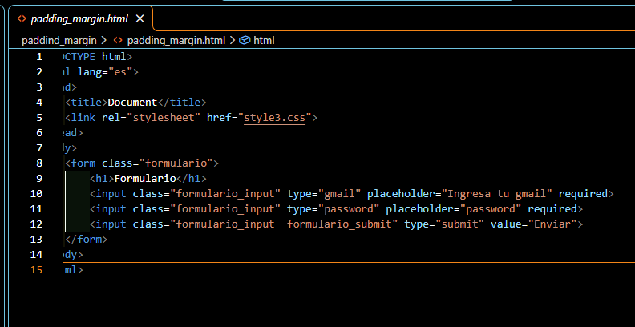
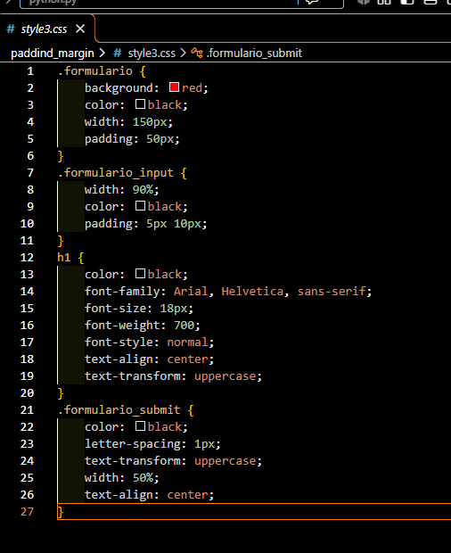
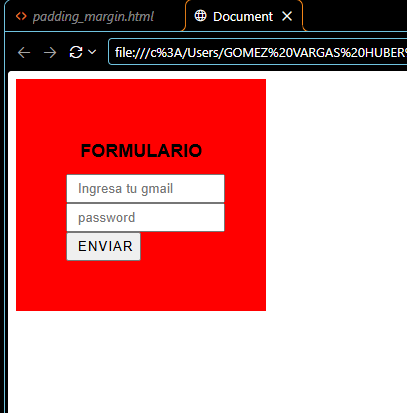

# Práctica 06: Padding en CSS

## 📌 ¿Qué aprendí?

En esta práctica seguí trabajando con CSS desde Visual Studio Code. El ejercicio consistió en crear un formulario con fondo de color y darle espacio interno usando la propiedad `padding`. Durante el desarrollo, aprendí a usar clases para aplicar estilos a varios elementos, a usar dos clases en un mismo elemento y a ver cómo el espacio interno cambia el tamaño final de una caja.

## 🛠️ Desarrollo de la práctica

### 1. Creación del código HTML

Primero, elaboré el archivo `padding_margin.html`, donde conecté la hoja de estilos con la etiqueta `<link>` y el atributo `href="style3.css"`. En el `<body>` creé un `<form>` con la clase `formulario`, que contiene un título `<h1>`, un campo para el correo, un campo de contraseña y un botón de enviar. A los campos y al botón les puse la clase `formulario_input`, y al botón además le agregué la clase `formulario_submit`, para poder darle estilos propios.

### 2. Creación del código CSS

Después, creé el archivo `style3.css`, donde usé selectores de clase y uno de etiqueta:

- `.formulario`: le puse fondo rojo, un ancho de `150px` y un `padding` de `50px`, que le da espacio entre el borde y el contenido.
- `.formulario_input`: le di un ancho de `90%` y un `padding` de `5px 10px` (5px arriba y abajo, 10px a los lados).
- `h1`: lo puse en negro, centrado, en mayúsculas y con letra Arial.
- `.formulario_submit`: le puse mayúsculas, un poco de espacio entre letras con `letter-spacing` y un ancho de `50%`.

### 3. Visualización en el navegador

Finalmente, abrí el archivo en el navegador para comprobar el resultado. Se ve un cuadro rojo con el título "FORMULARIO" y los campos adentro. El cuadro se ve más grande que los 150px que le puse de ancho porque el `padding` se suma al tamaño del elemento, así que quedó con 250px en total (150px + 50px de cada lado).

## 💡 Padding y margin

Entendí que el **padding** es el espacio que hay *dentro* de un elemento, entre su borde y su contenido, y que el **margin** es el espacio que hay *afuera*, entre ese elemento y los demás. En este ejercicio practiqué el padding, y el margin lo voy a practicar en los próximos ejercicios.

## ✅ Conclusión

Con esta práctica aprendí a usar el padding para darle espacio interno a los elementos y a usar clases para aplicar estilos a varios elementos a la vez. En las próximas prácticas voy a seguir con el margin y otras propiedades de CSS.
