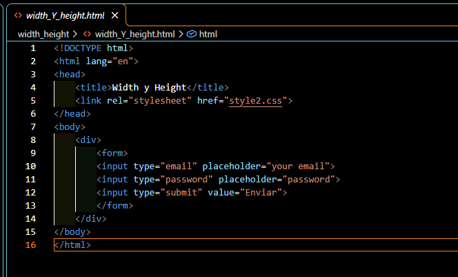
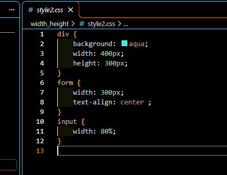
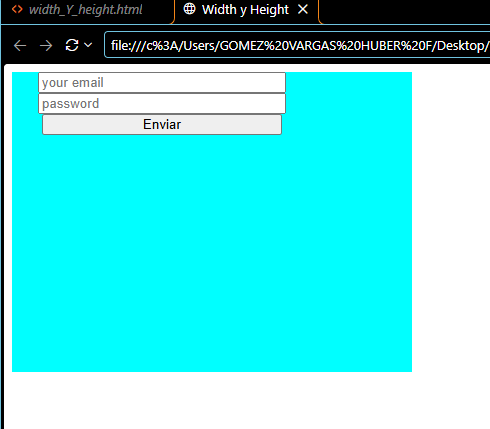

# Práctica 05: Width y Height en CSS

## 📌 ¿Qué aprendí?

En esta práctica seguí trabajando con CSS desde Visual Studio Code. El ejercicio consistió en darle tamaño a un contenedor y a los elementos de un formulario usando las propiedades `width` (ancho) y `height` (alto). Durante el desarrollo, aprendí a usar medidas en píxeles y en porcentajes, y a ver cómo un elemento puede quedar dentro de otro.

## 🛠️ Desarrollo de la práctica

### 1. Creación del código HTML

Primero, elaboré el archivo `width_Y_height.html`, donde definí la estructura básica del documento y conecté la hoja de estilos con la etiqueta `<link>` y el atributo `href="style2.css"`. En el `<body>` creé un `
` que funciona como contenedor y, dentro de él, un `<form>` con un campo de email, un campo de contraseña y un botón de enviar.

### 2. Creación del código CSS

Después, creé el archivo `style2.css`, donde apliqué estilos a tres etiquetas:

- `div`: le puse un fondo de color aqua (`background`) y un tamaño de `400px` de ancho (`width`) por `300px` de alto (`height`).
- `form`: le di un ancho de `300px` y centré el contenido con `text-align: center`.
- `input`: le puse un ancho de `80%`, es decir, que ocupa el 80% del ancho del elemento que lo contiene.

### 3. Visualización en el navegador

Finalmente, abrí el archivo en el navegador para comprobar el resultado. Se ve un cuadro de color aqua de 400px por 300px y, dentro de él, el formulario con los campos y el botón. Los campos no ocupan todo el ancho del formulario porque su tamaño está en 80%.

## 💡 Píxeles y porcentajes

Entendí que los **píxeles (px)** son una medida fija, mientras que los **porcentajes (%)** dependen del tamaño del elemento que contiene al otro. Por eso el `input` cambia de tamaño si cambia el ancho del `form`.

## ✅ Conclusión

Con esta práctica aprendí a controlar el tamaño de los elementos con `width` y `height` y a usar diferentes unidades de medida. En las próximas prácticas voy a seguir con más propiedades de CSS, como márgenes y padding.
